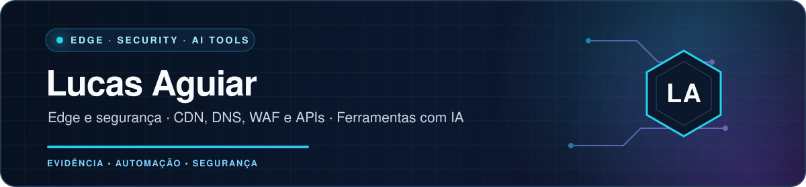
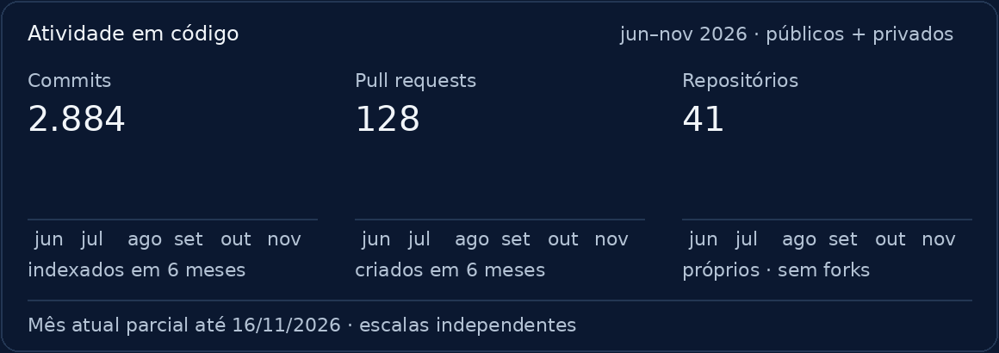

  

  
  
  

  Sou engenheiro de <strong>edge e segurança</strong>: CDN, DNS, WAF e APIs para clientes estratégicos,
  com mais de 18 anos em tecnologia.

  Também construo as <strong>ferramentas com IA</strong> que uso nesse trabalho: agentes, automações e integrações
  que encurtam a análise de incidentes e deixam cada conclusão presa a uma evidência.

  <picture>
    <source media="(prefers-reduced-motion: reduce)" srcset="./assets/versioned/activity-b186d7fef0ce.svg">
    
  </picture>

## O que eu construo

<h3></h3>

CDN, cache, DNS, WAF e bot protection para clientes estratégicos. Causa raiz a partir de logs, indicadores e evidências, com mitigação rápida em incidente crítico.

<h3></h3>

Claude Code, Codex e Gemini conectados por MCP, com modelos fixados e revisão cruzada, analisando tickets, HAR, NetLog, MTR e access logs. A decisão crítica continua testável e auditável.

<h3></h3>

Python, Node.js, n8n e Terraform com Jira, Freshdesk, Slack, ServiceNow e APIs da Azion. Testes nos fluxos negativos e de borda, rollback, SHA-256 e dado sensível mascarado.

## Stack em uso

  
  
  
  
  
  
  
  

  
  
  
  
  
  
  
  

`Express` · `EJS` · `pytest` · `unittest` · `node:test` · `Vitest` · `Azion SQL` · `JSON` · `CSV`

Inteligência artificial

  
  
  
  
  

`Claude API` · `OpenAI API` · `Amazon Bedrock` · `RAG` · `tool use` · `Grafos de conhecimento`

## Projetos selecionados

> Os repositórios abaixo estão privados no momento. Os links serão disponibilizados individualmente após solicitação.

<table>
  <tr>
    <td width="50%" valign="top">
      <h3></h3>
      
Ferramenta local para estruturar prompts e orquestrar ferramentas assistidas por IA, com arquitetura MVC/Services e histórico em SQLite.

      
<code>Python</code> <code>Streamlit</code> <code>SQLite</code> <code>pytest</code>

    </td>
    <td width="50%" valign="top">
      <h3></h3>
      
Automação para consultar e consolidar tickets Jira e Freshdesk, com aplicação Streamlit, cache, retries e workflows n8n para triagem operacional.

      
<code>Python</code> <code>Streamlit</code> <code>n8n</code> <code>Jira/Freshdesk APIs</code>

    </td>
  </tr>
  <tr>
    <td width="50%" valign="top">
      <h3></h3>
      
Consulta e análise estruturada de issues do Jira Cloud, incluindo JQL, paginação, segurança HTTP e testes automatizados.

      
<code>Node.js</code> <code>Express</code> <code>Jira REST API</code> <code>Helmet</code>

    </td>
    <td width="50%" valign="top">
      <h3></h3>
      
Aplicação desktop para identificar, remover e restaurar artefatos antes de commits Git, com SHA-256, rollback, quarentena e proteção contra symlinks.

      
<code>TypeScript</code> <code>React</code> <code>Electron</code> <code>Vitest</code> <code>Playwright</code>

    </td>
  </tr>
</table>

## Como eu trabalho

<table>
  <tr><td width="64" valign="middle"></td><td><strong>Automação com rastreabilidade:</strong> comportamento observável e reproduzível.</td></tr>
  <tr><td width="64" valign="middle"></td><td><strong>Segurança por padrão:</strong> falhas, limites de API e dados sensíveis tratados explicitamente.</td></tr>
  <tr><td width="64" valign="middle"></td><td><strong>Arquitetura pragmática:</strong> separação entre integrações, regras de negócio e interfaces.</td></tr>
  <tr><td width="64" valign="middle"></td><td><strong>Qualidade verificável:</strong> fluxos positivos, negativos e casos de borda.</td></tr>
  <tr><td width="64" valign="middle"></td><td><strong>IA com supervisão:</strong> decisões críticas continuam testáveis e auditáveis.</td></tr>
</table>

  

